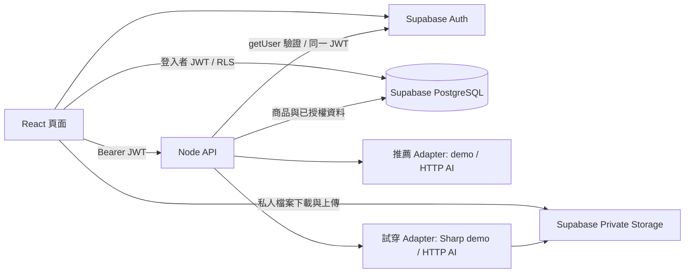

# KIKI — 你的風格，由你定義

繁體中文服飾購物 Demo。React + TypeScript + Vite、Node.js API、**Supabase Auth / PostgreSQL / Private Storage**。目前沒有連接或修改任何遠端資料庫，也沒有部署。

介面以**手機使用為主**：底部五入口、固定試穿／收藏與分身下一步、可展開的衣櫃設定、較大的表單與觸控區。桌機與平板仍保留完整流程；詳細設計與修改檔案見 [手機 UI / UX 說明](docs/MOBILE-UX.md)。

## 專案盤點與實作範圍

開始工作時 `C:\Users\linei\Desktop\coding\kiki` 為空目錄，沒有框架、資料庫、商品、圖片、API、頁面、設計系統或 Git 記錄可沿用。因此本次為新增專案，沒有取代或刪除既有功能。

選擇 React / Vite 處理互動介面；Supabase 負責帳號、持久化資料與私人檔案；輕量 Node HTTP API 負責 JWT 驗證、推薦與圖片合成，使用登入者 JWT 遵守 RLS，**不需要 service_role**。不使用 SQLite、localStorage 假資料庫或假登入；Supabase SDK 僅以 localStorage 管理登入 session。

## 快速啟動

需要 Node.js 22.13+（本次使用 24.22.1）、npm，以及獨立的 Supabase 開發／測試專案。

```powershell
npm.cmd ci
Copy-Item .env.example .env
# 編輯 .env 的 SUPABASE_URL 與 SUPABASE_PUBLISHABLE_KEY
npm.cmd run dev
```

前端：<http://127.0.0.1:5173>；API：<http://127.0.0.1:3001>。Windows 使用 `npm.cmd` 可避免 PowerShell 的 npm.ps1 執行政策問題。`Ctrl+C` 停止開發伺服器。

尚未設定 Supabase 時，首頁與商品目錄可預覽本機 fixtures；畫面會明確標示未連線。註冊、推薦、分身、試穿及私人資料操作不會假裝成功。設定 `.env` 後重新啟動。

正式建置的**本機**預覽：

```powershell
npm.cmd run build
# APP_ORIGIN 改為 http://127.0.0.1:3001，重啟後執行
npm.cmd start
```

`npm start` 同時提供 `dist` 與 API；沒有任何部署腳本或開機自動 Migration。

## Supabase 設定與 Migration

### 選擇一：獨立測試專案

1. 在 Supabase 建立新的開發／測試專案。不要使用正式商店資料庫。
2. 在 SQL Editor 按順序執行下列兩個檔案。這是需要由你明確執行的設定步驟，應用程式不會自動套用。
   - `supabase/migrations/202611140001_kiki_schema.sql`：六個 kiki_ 資料表、RLS、註冊 trigger、Private Storage bucket 與四種檔案權限。
   - `supabase/migrations/202611140002_demo_catalog.sql`：八件展示商品，衝突時不覆蓋既有商品。
3. 在 Authentication 的 URL Configuration 設定 Site URL 為 `http://127.0.0.1:5173`，將相同網址加入 Redirect URLs。若使用其他埠或主機，需一起更新。
4. 使用 Email / Password。正式預設若要求驗證信箱，註冊畫面會引導使用者收信；登入後進入分身。為了即時展示，可僅在測試專案關閉 Confirm email。密碼至少八字元。
5. `.env` 填入 Project URL 及 **publishable key**（或舊版 anon JWT）。不得使用 `service_role` / `sb_secret_`；伺服器會拒絕將秘密 Supabase 金鑰送到前端。
6. 重新啟動 `npm run dev`，開始完整 Demo。

Migration 使用獨立 `kiki_` 表名；如果你的資料庫已有同名資料表或 bucket，請先人工檢視與調整，不能直接重跑。未提供會清除資料的 rollback。商品 seed 清楚標示為展示 fixtures，不是真實商店、價格承諾或實際庫存。

### 選擇二：本機 Supabase

需要 Docker Desktop 已啟動及 Supabase CLI。參照 [Supabase 官方本機開發指南](https://supabase.com/docs/guides/local-development/cli/getting-started)。本次環境有 Docker CLI，但 Docker daemon 未運作，因此**沒有啟動或驗證真實本機 Supabase**。

```powershell
npx supabase start
npx supabase status
```

本目錄已有 `supabase/config.toml`，本機啟動會使用此專案的 migrations。將本機 URL 和 anon／publishable key 填入 `.env`。不要對遠端／正式專案執行 `db reset`。本機設定關閉驗證信以便展示；這項設定不應照搬到正式環境。

## 環境變數

| 變數 | 用途 | 預設／需求 |
| --- | --- | --- |
| `SUPABASE_URL` | Supabase URL | 必填，測試專案或本機 |
| `SUPABASE_PUBLISHABLE_KEY` | 公開 publishable / anon key | 必填；遵守 RLS，不是管理秘密 |
| `PORT` | Node API 埠 | `3001` |
| `WEB_PORT` | Vite 埠 | `5173` |
| `APP_ORIGIN` | 允許發起寫入 API 的網站 Origin | `http://127.0.0.1:5173` |
| `RECOMMENDATION_MODE` | 推薦 Adapter | `demo` 或 `ai` |
| `TRYON_MODE` | 試穿 Adapter | `demo` 或 `ai` |
| `AI_RECOMMENDATION_URL` / `AI_RECOMMENDATION_KEY` | 正式推薦 HTTP Adapter URL 與秘密 | 僅 `ai` 模式需要，只在後端 |
| `AI_TRYON_URL` / `AI_TRYON_KEY` | 正式試穿 HTTP Adapter URL 與秘密 | 僅 `ai` 模式需要，只在後端 |

Supabase publishable key 可供 SDK 使用；資料保護依賴 Auth 與 RLS，不依賴隱藏此公開金鑰。[官方金鑰說明](https://supabase.com/docs/guides/api/api-keys)。AI 秘密沒有 `VITE_` 前綴，不會打包到瀏覽器。請勿提交 `.env`。

## 完整 Demo 操作路徑

1. **首頁 `/` → 註冊 `/auth`**：填暱稱、信箱、密碼、確認密碼及照片用途確認。需要驗證信箱時先收信。
2. **照片 `/avatar`**：上傳 JPG / PNG / WebP，或允許相機拍攝正面、側面全身照；相機提供姿勢框與三秒倒數。預覽、重新拍攝／上傳、確認照片。
3. **身形設定**：輸入身高、體重，選填肩寬、胸圍、腰圍、臀圍，右側概念輪廓即時更新。進階資料可以略過。
4. **Fit Preference**：選貼身、合身、微寬鬆或 Oversized；自主勾選是否讓推薦參考身形與偏好。完成後保存至 Supabase，顯示成功動畫。
5. **商品 `/products`**：分類、搜尋、排序，或打開商品詳細頁看尺碼、示範庫存、材質、顏色與版型。愛心可加入衣櫃。
   商品頁另有五列版型分析（版型、肩寬、合身度、袖長、衣長），試穿頁提供可展開的精簡版。刻度為 −2 較緊至 +2 較鬆，0 符合偏好；切換尺寸即時更新胸圍分析與穿搭提醒。只有開啟身形與偏好授權時才使用個人數據，否則依「合身」公開基準比較商品版型。合身度為示範規則估算（偏好預留胸圍量：4／10／16／24 cm，每差 6 cm 一格），非實際量測或 AI 判斷；缺少肩寬、袖長、理想衣長等比較資料時標示「資料不足」。
6. **穿搭助理**：輸入「我想找一件上台報告適合穿的外套」或「我喜歡微寬鬆，預算 2000 元以下」。顯示實際商品卡片、理由與立即試穿。
7. **試穿 `/fitting/:id`**：沿用已保存分身，不重拍、不重填。進入後以預設選項生成；可切換尺寸／顏色再重新生成、切換商品、對照原照片。每張結果可由 `?look=:uuid` 重新開啟。
8. **保存**：為穿搭命名，保存至衣櫃 `/wardrobe`。重整或登出登入後仍可讀取。
9. **個人衣櫃**：查看收藏穿搭／商品／試穿紀錄、再次試穿、移除收藏、刪除試穿、更新偏好與授權、更新照片與身形，或確認刪除所有私人分身資料。

已有分身的帳號重新登入後直接進入商品或原本要求的衣櫃／試穿頁；沒有分身時先進入建立流程。

## 已實作與模擬邊界

| 功能 | 實際行為 |
| --- | --- |
| 會員、驗證信、登入、登出、重設密碼 | Supabase Auth 真實 SDK，需設定專案 |
| 私人資料、分身、偏好、收藏、穿搭 | PostgreSQL 真實 CRUD + owner RLS |
| 私人照片與成果 | Private Storage；以 JWT 下載後轉為記憶體 Blob URL；不建立公開或永久簽章網址 |
| 拍照品質 | 瀏覽器檢查格式、10 MB 上限、至少 400×400、40 MP 上限、亮度與畫面變異；非人臉、姿勢或專業清晰度辨識 |
| 身形輪廓 | SVG 概念視覺化；不是精準人體量測或 3D 掃描；進階數據會改變相應輪廓 |
| Demo 推薦 | 規則配對：標籤、場合、版型偏好、預算與有貨商品；不呼叫 LLM |
| Demo 試穿 | **Sharp 將使用者照片與商品 SVG 合成**，存成 WebP，圖片內有英文 Demo 浮水印；無去背、姿態追蹤、AI 生成或布料模擬 |
| Demo 的尺寸／顏色 | 保存為選項；圖像固定採商品主色與固定比例，不因尺寸／其他色票變化。介面有明確說明 |
| 正式 AI Adapter | 已實作 HTTP 請求、逾時、輸出驗證與明確錯誤，不曾接上或驗證真實供應商 |

所有視覺結果皆不保證實際尺碼、舒適度與合身。身形輪廓與試穿影像分開，**沒有宣稱數據能控制試穿圖**。

## 架構與資料流



資料表：`kiki_profiles`（偏好與授權）、`kiki_products`、`kiki_avatars`、`kiki_tryons`、`kiki_favorites`、`kiki_outfits`。除公開商品外，都以 `auth.uid() = user_id` 限制。複合外鍵避免把自己的試穿／收藏連到他人分身或結果；完成狀態才可保存穿搭。

Storage 路徑：`<user-id>/photos/<uuid>-front.jpg`、`<user-id>/photos/<uuid>-side.jpg`、`<user-id>/results/<tryon-id>.webp`。檔案讀寫刪除都驗證第一層資料夾的 owner。上傳圖片經 Canvas 轉成 JPEG，移除原始 EXIF。切換帳號時清理 UI 中的私人資料；圖片元件卸載時回收 Blob URL。

刪除私人資料：先逐批呼叫 Storage API 刪除自己的照片／成果，再刪除 avatar（以 FK cascade 清除 tryons / outfits），最後關閉個人化與外部 AI 授權。不刪除帳號、暱稱、商品愛心或穿著偏好。步驟失敗可重試；Storage 與 Postgres 沒有跨服務交易，極端網路失敗可能需要再次執行清理。更新照片先上傳，成功保存後清理舊照片；失敗時清理未使用的新檔案，保留已提交檔案。

檔案分工：

```text
src/
  App.tsx                  路由、導覽、首頁、登入保護
  context.tsx              Supabase session、個人資料與共用狀態
  components/
    PhotoCapture.tsx       拍照／上傳與基本品質檢查
    BodyPreview.tsx        獨立的 SVG 身形視覺化
    MobileNavigation.tsx   手機底部導覽與軟鍵盤避讓
    UI.tsx                 商品卡片、私人圖片、Modal 與共用狀態
  pages/
    Auth.tsx               註冊／登入／重設密碼
    Avatar.tsx             三階段建立分身
    Catalog.tsx            商品列表、商品詳細與穿搭助理
    Fitting.tsx            試穿、重試、切換商品與保存
    Wardrobe.tsx           收藏、紀錄、偏好、授權與資料刪除
  lib/                     API 與 Supabase 資料操作
  styles.css               響應式設計、狀態、動畫與減少動態偏好
  mobile.css               手機主要流程、觸控尺寸、固定操作與安全區域
server/
  index.ts                 API、JWT 驗證、RLS 讀寫、限制頻率、靜態檔案
  recommend.ts             規則與正式推薦 Adapter
  tryon.ts                 Sharp Demo 與正式 HTTP 試穿 Adapter
shared/                    共用型別、Zod 驗證、唯一展示商品 fixtures
supabase/migrations/       Schema、RLS、Storage、商品資料 Migration
public/                    本機商品 SVG、首頁圖片與 favicon
scripts/                   開發啟動、商品素材與 seed 產生器
tests/                     domain、實際 Node API、PG RLS、瀏覽器、真實 Supabase 驗收入口
```

API 契約與正式 AI 步驟見 [docs/AI-ADAPTERS.md](docs/AI-ADAPTERS.md)。驗證結果與限制見 [docs/VERIFICATION.md](docs/VERIFICATION.md)。

## 檢查指令

```powershell
npm.cmd run typecheck
npm.cmd run lint
npm.cmd run build
npm.cmd test
npm.cmd run test:e2e
npm.cmd run test:build
npm.cmd run test:live
```

E2E 使用系統 Chrome，不安裝額外瀏覽器；測試用埠為 4179（前端）、3129（實際 API）、54329（明確標示的 Supabase HTTP 替身）。請先確保這些埠未被占用。`test:live` 需另設兩個測試帳號環境變數，沒有資訊時會跳過，不會冒充通過。詳見驗證文件。

商品 SVG 與 Migration seed 來自 `shared/catalog.ts`。需要修改展示商品時，執行 `node scripts/assets.mjs` 同步產出素材與 seed **檔案**，不會寫入資料庫。既有專案已套用 seed 後，要新增另一份 Migration 才會更新資料，不要覆寫已套用 Migration 再直接推正式環境。

首頁照片來源：[Unsplash](https://images.unsplash.com/photo-1483985988355-763728e1935b)，本機檔案 `public/images/hero.jpg`；下載來源為 images.unsplash.com/photo-1483985988355-763728e1935b。商品圖為專案 SVG 示意圖。字型使用系統字型，執行 Demo 不依賴外部字型服務。
